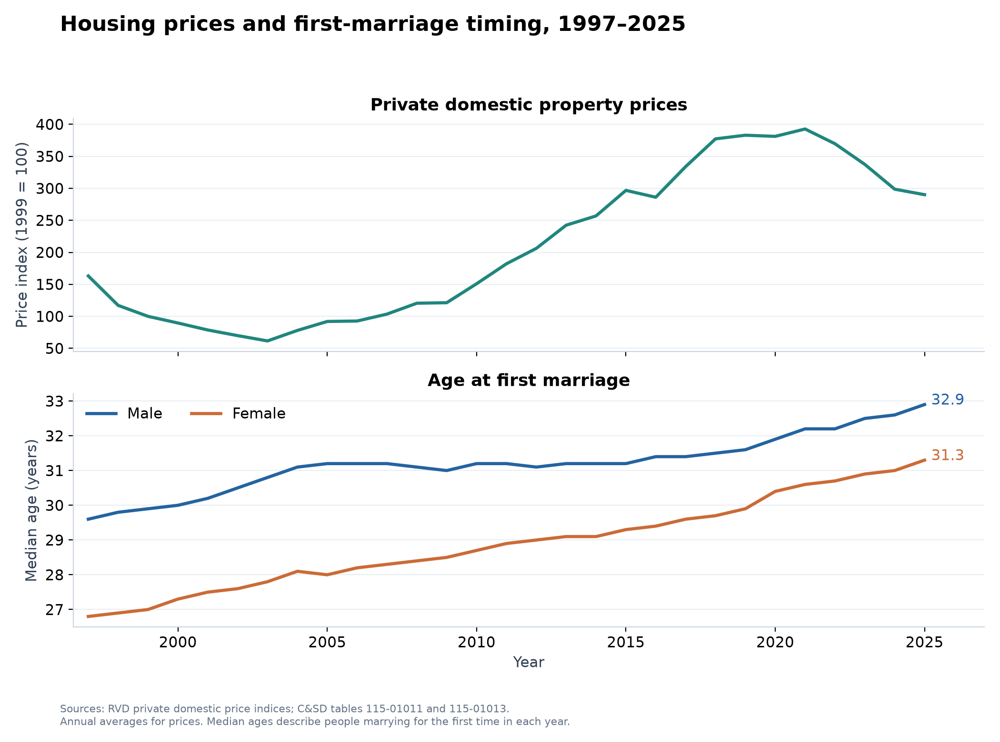
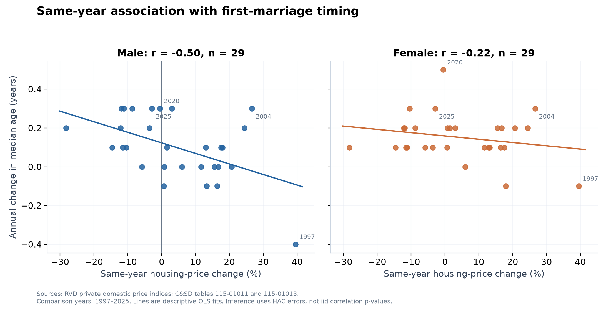

# Housing Prices and First Marriage in Hong Kong, 1997–2025

Semester project, Class B, Team 03. Portfolio owner: Xian Haoran.

## Question and contribution

How are annual housing-price changes associated with first-marriage timing and age composition in Hong Kong?

This folder preserves the team's V2 analysis. My documented contribution is coordination and reporting: tracking progress, explaining the research motivation, data definitions and EDA, and integrating the presentation narrative. Analytical and development work was shared across the team; I do not claim sole authorship of these scripts or results.

## Data and provenance

- Rating and Valuation Department (RVD): private domestic property price index, annual All Classes series, 1999 = 100. [Official workbook](https://www.rvd.gov.hk/doc/en/statistics/his_data_4.xls).
- Census and Statistics Department (C&SD): [Table 115-01011](https://www.censtatd.gov.hk/en/web_table.html?id=115-01011), median age at first marriage, in years.
- C&SD: [Table 115-01013](https://www.censtatd.gov.hk/en/web_table.html?id=115-01013), first marriages by sex and age group.

The supplied snapshot is dated 6 November 2026. URLs, raw-file SHA256 checksums and extraction details are in [the source register](research/source_register_v2.json). The [variable dictionary](research/variable_dictionary_v2.csv) records units. Raw observations before 1997 provide the calculation baselines; the main analysis uses 29 complete years, 1997–2025.

Age-group shares divide first marriages in an age group by all first marriages of the same sex and year. They are not population marriage rates. The male–female median-age gap is not the age gap within married couples.

## Methods and findings

Annual price growth and changes in median marriage age are compared in the same year and with a one-year price lag. Analyses include Pearson and Spearman correlations, OLS with HAC uncertainty, multiple-testing adjustments and sample-window sensitivity checks.

- Male median age increased from 29.6 to 32.9; female median age increased from 26.8 to 31.3.
- Male same-year Pearson r = −0.504 (29 years). None of the four primary tests is below 0.05 after Holm adjustment.
- Excluding 1997 reduces the male same-year correlation to −0.336; using 2004–2025 reduces it to −0.191.





## Limitations

This is an annual aggregate observational study with a small sample. Structural changes, omitted economic and demographic variables, and changes in who marries can influence results. A negative association with an age change means a smaller increase, not necessarily earlier marriage. Correlation is not causation. Population denominators and affordability measures are priorities for further work.

## Reproduce

Use Python 3.12. From this folder:

```bash
python -m venv .venv
source .venv/bin/activate  # Windows: .venv\Scripts\activate
python -m pip install -r requirements.txt
python research/prepare_data_v2.py
python analysis/run_analysis_v2.py
python analysis/build_report_v2.py
python analysis/validate_v2.py
```

The provided XLSX in `research/` is a reading copy of the original RVD XLS in `data/raw/`. Re-downloading the XLS requires conversion to that XLSX path before data preparation. Network access is not required to analyze the included snapshot after dependencies are installed.

The executed [Notebook](outputs_v2/housing_marriage_analysis_v2.ipynb) records the analytical workflow. The validation script checks raw-file hashes, annual values, transformations, correlations, multiple-testing corrections, sensitivity samples and stored Notebook outputs. See `REPRODUCIBILITY.md` for the verification performed for this portfolio release.

## Folder guide

- `data/raw/`: original government data snapshot.
- `data/processed/`: matched annual data.
- `research/`: preparation script, source register and variable dictionary.
- `analysis/`: analysis, report, Notebook and validation scripts.
- `outputs_v2/`: executed Notebook, charts, tables, diagnostics and reports.
- `README_v2.md`: original Chinese reproduction notes.

## Rights and attribution

Data and underlying publications remain subject to the publishers' copyright notices. This is a noncommercial educational portfolio; RVD and C&SD are acknowledged as the data sources. The charts and interpretations are the team's analysis, not government endorsements. No blanket license is granted over third-party data or teammates' work.

C&SD statistical data are reused under its [Important Notices](https://www.censtatd.gov.hk/en/page_31.html): the HKSAR Government is acknowledged as the intellectual property rights owner. The processed CSV, calculated changes, shares and charts are derived transformations; original JSON files are preserved in `data/raw/`. Consult the [RVD website](https://www.rvd.gov.hk/en/) for its applicable notices before further reuse.
