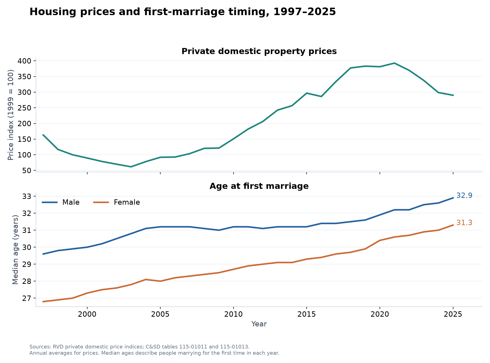
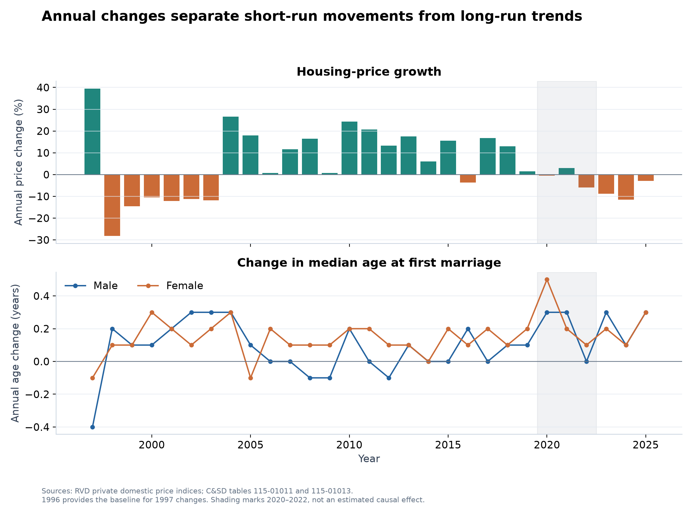
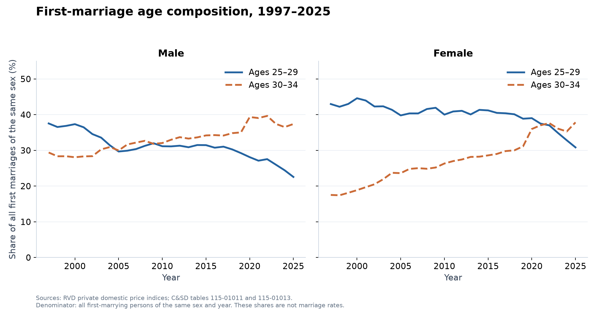
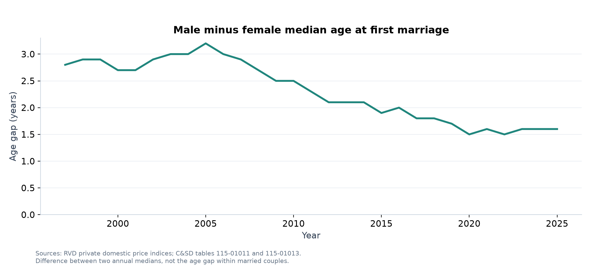
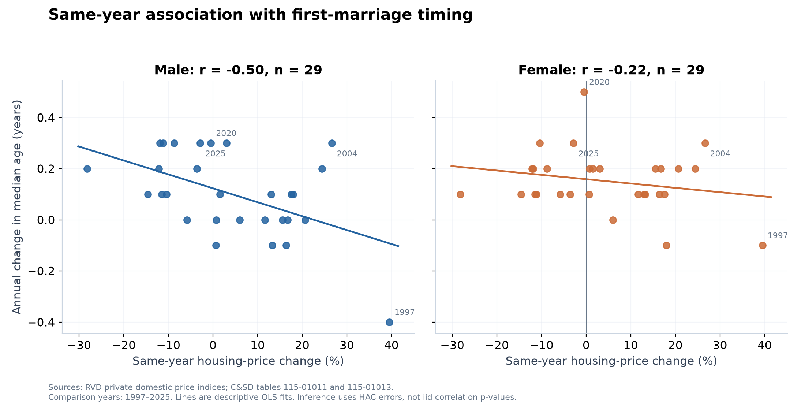
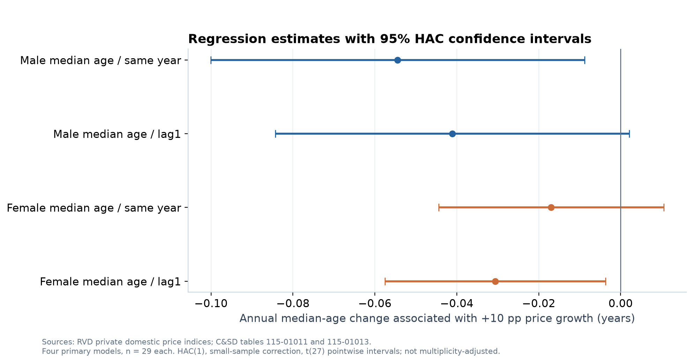
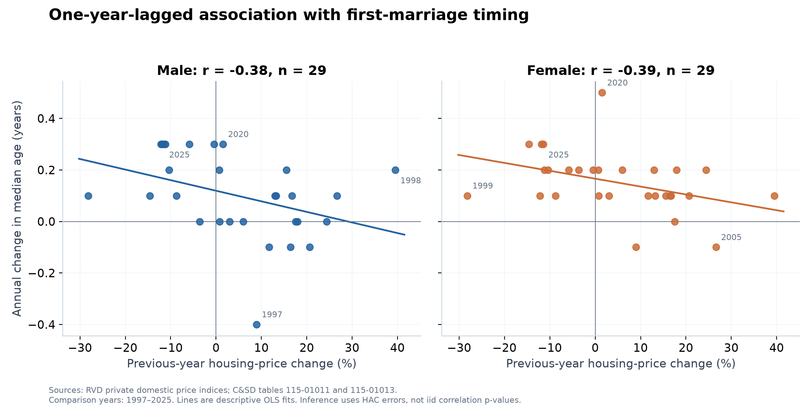
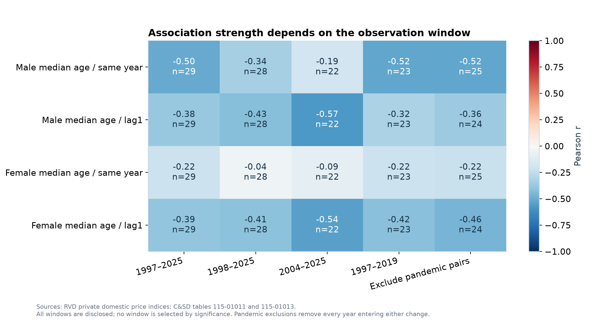

# 香港房价与初婚变化 六步分析报告

官方数据下载版本：2026年11月6日。V2，29年完整比较期。

## 1 描述性统计

分析以全港日历年为单位，合并RVD全港私人住宅All Classes年均价格指数、C&SD男女初婚年龄中位数及分年龄组初婚人数。主研究期统一为1997—2025年，同期和一年滞后均有29个完整配对。1995—1996年仅用于计算前置变化与滞后，不计入主研究期。

房价涨跌幅=100×(P_t/P_(t−1)−1)，单位%；初婚年龄变化=A_t−A_(t−1)，单位岁；年龄组占比=100×该组初婚人数/同年同性别全部初婚人数；占比年度变化单位为百分点。人数不是夫妇对数，占比也不是年龄别初婚率。

保留官方原始文件，不填补或插值。年度无重复，所选29年指标无缺失，各年龄组人数加总与官方总数一致。初婚年龄变化按原始0.1岁精度处理，恢复Spearman排名的并列值；年龄组占比采用未按展示精度舍入的计算值。

| 指标 | 1997 | 2025 | 均值 | 标准差 |
| --- | --- | --- | --- | --- |
| 房价指数（1999=100） | 163.10 | 290.10 | 209.43 | 116.72 |
| 男性初婚年龄（岁） | 29.60 | 32.90 | 31.20 | 0.82 |
| 女性初婚年龄（岁） | 26.80 | 31.30 | 28.90 | 1.30 |
| 男女中位数之差（岁） | 2.80 | 1.60 | 2.31 | 0.57 |
| 男性25—29岁初婚占比（%） | 37.54 | 22.56 | 31.10 | 3.69 |
| 男性30—34岁初婚占比（%） | 29.40 | 37.38 | 33.03 | 3.45 |
| 女性25—29岁初婚占比（%） | 42.97 | 30.84 | 40.11 | 3.06 |
| 女性30—34岁初婚占比（%） | 17.52 | 37.84 | 27.13 | 6.25 |

## 2 房价与初婚年龄趋势分析

男性初婚年龄中位数由29.6岁升至32.9岁，增加3.3岁；女性由26.8岁升至31.3岁，增加4.5岁。研究期内女性中位数增加更多。男性中位数减去女性中位数的差值由2.8岁缩小至1.6岁，这不是夫妻年龄差。

房价年均指数最低为2003年的61.6，最高为2021年的392.7。2021—2025年房价指数下降26.1%，但男女初婚年龄中位数均再提高0.7岁。这个阶段说明两条长期路径并非简单同步，不能仅凭房价高和初婚年龄高就确认联系。

房价水平与男女初婚年龄水平的Pearson相关分别为0.699、0.855，但改用同期年度变化后变为−0.504、−0.218。两类相关回答不同问题，方向反转说明定义和时间趋势会明显影响结果。水平相关只作描述，不作为主推断证据。

ADF与KPSS作为附录诊断：房价和初婚年龄水平序列不支持直接作平稳水平回归；房价涨跌和男女初婚年龄变化的检查较支持采用变化量。ADF最多1阶滞后、AIC选择，水平序列含趋势，变化序列含常数；KPSS固定1阶。29年的检验能力有限，不能把不拒绝当成证明。

## 3 初婚年龄结构与性别差异分析

男性25—29岁初婚占比由37.54%降至22.56%，下降14.98个百分点；30—34岁由29.40%升至37.38%，提高7.98个百分点。女性相应变化为42.97%降至30.84%，以及17.52%升至37.84%。女性30—34岁组提高20.32个百分点。

男性30—34岁占比首次超过25—29岁是在2005年，但2009年短暂回落到其下方，2010年起持续高于后者。女性则从2022年起持续高于后者。这提供了比“整体晚婚”更具体的初婚者年龄组成证据；不等于追踪同一批人延迟了多少年。

性别比较以描述性差异为主。补充以男女初婚年龄变化之差直接回归房价变化：同期未调整p约0.028，但两个探索性性别对比作Holm调整后约0.056；滞后未调整p约0.574。因此不将性别斜率差写成已确认结论，更不以“一边显著、另一边不显著”判定差异。

## 4 房价变化与初婚变化的相关分析

同期主模型为ΔA_t=α+βg_t+ε_t，男女分别估计。男性Pearson r=−0.504，女性r=−0.218；正确处理并列值后的Spearman分别为−0.404和−0.088。女性同期关联较弱，且对极端年份及相关方法更敏感。

单变量HAC回归显示，房价涨幅增加10个百分点，对应男性初婚年龄年度增幅约减少0.054岁，女性约减少0.017岁。这里是年度增幅较小，不是初婚年龄必然下降，也不是个人婚期提前。

回归采用Bartlett核HAC(1)、n/(n−k)小样本修正和t(27)区间。四个主模型的未调整p及Holm调整p一并报告。男性同期和女性滞后单项p低于0.05，但四个主要比较调整后均不低于0.05。95%区间是逐模型区间，未经同时推断调整。

男性同期Breusch–Pagan异方差F检验p约0.011，提示普通同方差标准误不适合直接用于主推断。HAC能调整协方差估计，却不能解决遗漏变量、反向关系或个别年份影响。

| 性别 | 设定 | Pearson r | Spearman ρ | 每10个百分点房价涨幅对应变化（岁） | 95% HAC区间 | HAC p | Holm调整p |
| --- | --- | --- | --- | --- | --- | --- | --- |
| 男性 | 同期 | -0.504 | -0.404 | -0.054 | [-0.100, -0.009] | 0.021 | 0.085 |
| 男性 | 滞后一年 | -0.379 | -0.498 | -0.041 | [-0.084, 0.002] | 0.062 | 0.123 |
| 女性 | 同期 | -0.218 | -0.088 | -0.017 | [-0.044, 0.011] | 0.217 | 0.217 |
| 女性 | 滞后一年 | -0.393 | -0.461 | -0.031 | [-0.058, -0.004] | 0.027 | 0.085 |

## 5 一年滞后关联分析

滞后模型以g_(t−1)解释ΔA_t，仍使用1997—2025这29个婚姻观察年。例如1997年初婚变化对应1996年房价变化，后者需要1995年指数作为基期。

男性滞后Pearson r=−0.379，女性r=−0.393；Spearman分别为−0.498和−0.461。女性在两种相关方法下都呈现比同期更明显的样本关联；男性Pearson的同期绝对值较大、Spearman的滞后绝对值较大。不能概括为“滞后一定比同期强”。未正式检验相关系数差值。

房价上一年涨幅增加10个百分点，对应男性本年初婚年龄年度增幅约减少0.041岁，女性约减少0.031岁。男性HAC p=0.062、女性p=0.027；Holm调整后分别约0.123、0.085。此处同期与滞后是分别拟合的简单模型，不是相互控制后的独立效应。

四个年龄组占比变化的8项探索性分析，Pearson约在−0.227至0.274之间，BH调整后均不显著。女性25—29岁占比变化的ADF和KPSS结论存在冲突，更应限制为探索性描述。

## 6 稳健性检验

完整29年为主样本，另报告剔除1997年的28年、2004—2025、1997—2019、剔除疫情结果年和剔除全部疫情相关原始年份配对。窗口选择用于检查影响，不能将显著的子样本替代主结果。2004年分界是阶段敏感性分析，不是已识别的结构断点。

男性同期相关从完整样本−0.504变为剔除1997年的−0.336，在2004—2025窗口进一步变为−0.191；其负向方向保持，但大小依赖早期年份。2004—2025男女滞后相关分别为−0.574和−0.539；这是窗口内的探索性结果，不能用更小p值升级主结论。

逐年剔除后，四个初婚年龄关联仍均为负；方向一致不意味着大小和显著性完全稳定。Spearman检查保留真实并列值；HAC带宽0、1、2均完整披露，不按结果选择带宽。

严格疫情剔除会同时检查年龄差及房价差所需的每个原始年份：同期剩25年，滞后剩24年。先在连续年度计算再筛选；HAC按真实日历间隔计算，不把2019和2023视为相邻年。

参考组员的方法，补充2、3、4年环形区块成对Bootstrap，每个设定10000次，种子20261106。3年区块下男性同期、男性滞后、女性同期、女性滞后r的95%区间约为[−0.76,−0.08]、[−0.73,−0.09]、[−0.48,0.13]、[−0.64,−0.19]。这些是未经多重比较调整的探索性相关区间，不是HAC回归系数区间；两种方法不能混用为同一检验。

残差低阶自相关检查未发现明显证据，但样本有限；男性同期异方差与1997年影响点需要保留在解释中。附录提供所有残差、影响点、平稳性、逐年剔除和Bootstrap结果。

| 性别 | 设定 | 完整29年 | 剔除1997 | 2004—2025 | 1997—2019 | 严格剔除疫情配对 |
| --- | --- | --- | --- | --- | --- | --- |
| 男性 | 同期 | -0.504 (n=29) | -0.336 (n=28) | -0.191 (n=22) | -0.516 (n=23) | -0.518 (n=25) |
| 男性 | 滞后一年 | -0.379 (n=29) | -0.429 (n=28) | -0.574 (n=22) | -0.318 (n=23) | -0.363 (n=24) |
| 女性 | 同期 | -0.218 (n=29) | -0.045 (n=28) | -0.089 (n=22) | -0.216 (n=23) | -0.220 (n=25) |
| 女性 | 滞后一年 | -0.393 (n=29) | -0.407 (n=28) | -0.539 (n=22) | -0.420 (n=23) | -0.462 (n=24) |

## 研究回答与价值

本研究的主要发现是：香港初婚者年龄结构在1997—2025年明显向较高年龄组移动，同时男女初婚年龄中位数差缩小；房价的年度波动与初婚变化之间存在负向样本关联，但关联强弱依赖性别、同期或滞后定义及研究窗口。

研究价值首先在于把“初婚年龄上升”细化为男女和两个年龄组的可比较变化。其次，明确区分长期水平与年度变化，展示同一数据可能产生方向不同的相关，避免把共同趋势误读为机制。最后，用完整样本、影响点和多种敏感性设定检验一个常见直觉，给出了可复核的证据边界。

现有结果不支持将香港长期初婚变化简单归因于私人住宅价格，也不能反过来证明住房因素不重要。房价指数不是个人住房负担，且未控制收入、就业、教育、迁移、公共房屋和利率等因素。数据只能识别年度汇总关联，不能识别个体婚姻决策或因果机制。

没有明确显著结果并不等于没有研究价值。这里真正能够汇报的是明确的长期人口变化、不同口径下关联的差别，以及结论对早期年份和研究窗口的敏感性。

## 复现与版本说明

V2保留原始下载版本，扩展前置房价到1995年，将同期和滞后比较统一为29年，并修复初婚年龄变化Spearman的浮点并列值问题。原V1文件保留，未覆盖；不能将V1的28年系数与V2的29年系数拼到同一张结果表中。

输出包括9张主图、6张附图、CSV结果、已执行Notebook和汇报提纲。Notebook中的运行环境版本随包保留。来源SHA256见research/source_register_v2.json，数据字典见research/variable_dictionary_v2.csv。表中年龄中位数的原始精度为0.1岁，模型的小数位不代表更高的测量精度。

## 数据与方法来源

- [RVD住宅价格指数](https://www.rvd.gov.hk/doc/en/statistics/his_data_4.xls)

- [C&SD初婚年龄表115-01011](https://www.censtatd.gov.hk/en/web_table.html?id=115-01011)

- [C&SD初婚人数表115-01013](https://www.censtatd.gov.hk/en/web_table.html?id=115-01013)

- [HAC协方差说明](https://www.statsmodels.org/stable/generated/statsmodels.regression.linear_model.RegressionResults.get_robustcov_results.html)

- [并列排名说明](https://docs.scipy.org/doc/scipy/reference/generated/scipy.stats.rankdata.html)

- [环形区块Bootstrap说明](https://bashtage.github.io/arch/bootstrap/generated/arch.bootstrap.CircularBlockBootstrap.html)