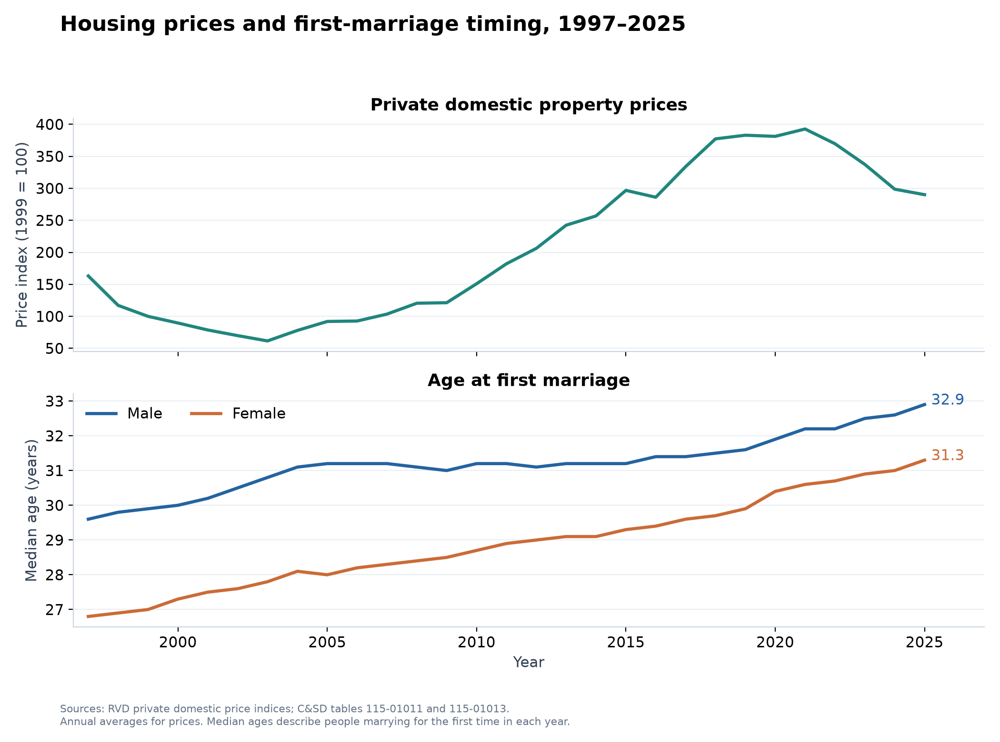
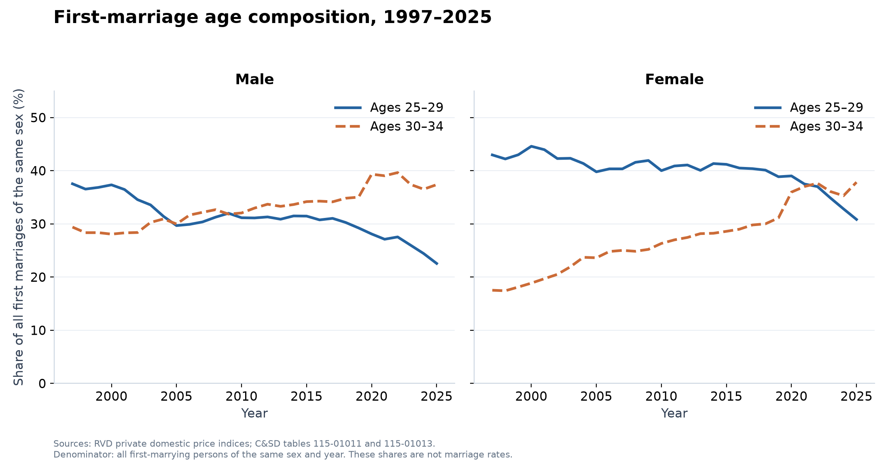
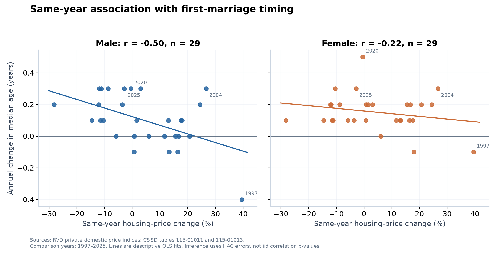
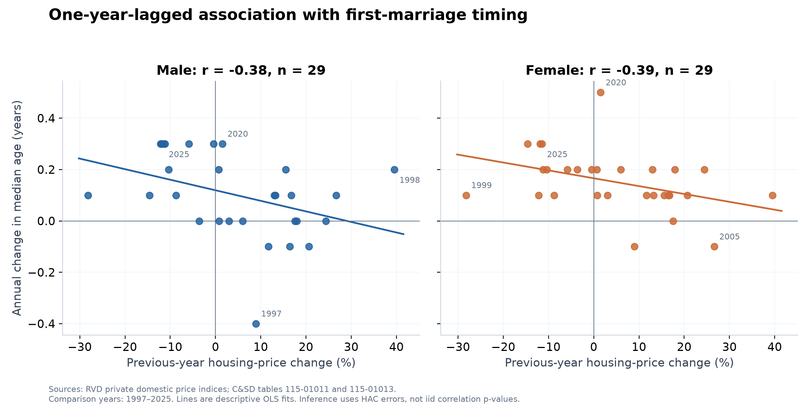
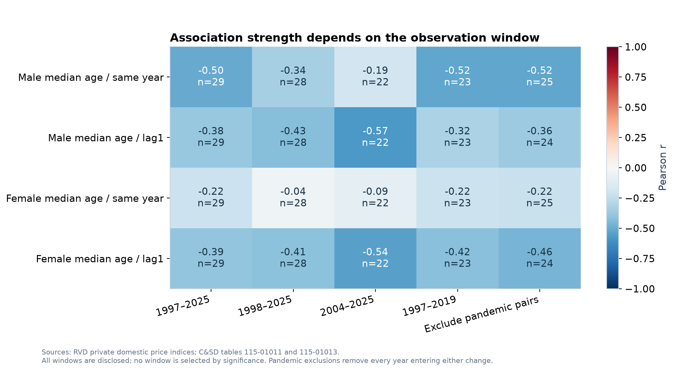

# 六步汇报版 每步一个重点

官方数据下载版本：2026年11月6日。V2，29年完整比较期。

## 1 描述性统计

汇报重点：三个官方来源，29年完整年度数据。用同年同性别全部初婚人数作占比分母。

建议讲法：我们按年份合并官方房价和初婚数据，利用1995—1996年前置数据保留1997—2025年全部29个同期及滞后配对。研究对象是年度汇总变化，不是个人结婚决定。

| 数据 | 指标 | 单位 |
| --- | --- | --- |
| 房价 | 全港私人住宅年均指数 | 1999=100 |
| 初婚时间 | 男女初婚年龄中位数 | 岁 |
| 年龄结构 | 25—29、30—34岁初婚占比 | % |

## 2 房价与初婚年龄趋势分析

一句话发现：房价经历升降，初婚年龄总体上升，二者不是简单同步。

建议讲法：男性初婚年龄提高3.3岁，女性提高4.5岁。尤其2021—2025年，房价指数下降26.1%，但男女初婚年龄都再提高0.7岁。因此，我们不能只看长期水平一起高，就认定房价推迟了结婚。

## 3 初婚年龄结构与性别差异分析

一句话发现：初婚者年龄结构向较高年龄组移动，男女转变时点不同。

建议讲法：女性30—34岁占比从17.5%升至37.8%，提高约20.3个百分点。男性从2010年起、女性从2022年起，这一年龄组持续超过25—29岁组。这里描述初婚者的构成，不是说同龄人有多少比例结婚。

## 4 房价变化与初婚变化的相关分析

一句话发现：完整样本男性同期负向关联较明显，女性同期较弱。

建议讲法：房价年度涨跌与初婚年龄年度变化的Pearson相关，男性约−0.50、女性约−0.22。负号表示房价涨幅较高时，年龄增幅倾向较小，不表示年龄一定下降。我们补充了HAC回归，但多重比较调整后不能把关系称为已确认。

## 5 一年滞后关联分析

一句话发现：女性滞后关联比同期更明显，男性没有统一的同期与滞后强弱排序。

建议讲法：上一年房价变化与今年初婚变化配对后，男女Pearson相关分别约−0.38和−0.39。男性的Spearman滞后相关更强，但Pearson同期更强。因此，我们不会简单总结为一年后影响更大，更不会把时间先后当成因果证据。

## 6 稳健性检验

一句话发现：负向方向较一致，强弱取决于样本窗口，1997年尤其重要。

建议讲法：去掉1997年，男性同期相关从−0.50变为−0.34；看2004—2025年则约−0.19。逐年剔除后方向仍为负，但大小会改变。研究的贡献是把初婚模式的长期变化和房价短期关联区分开，并说明现有证据能支持到哪里。

## 数据与方法来源

- [RVD住宅价格指数](https://www.rvd.gov.hk/doc/en/statistics/his_data_4.xls)

- [C&SD初婚年龄表115-01011](https://www.censtatd.gov.hk/en/web_table.html?id=115-01011)

- [C&SD初婚人数表115-01013](https://www.censtatd.gov.hk/en/web_table.html?id=115-01013)

- [HAC协方差说明](https://www.statsmodels.org/stable/generated/statsmodels.regression.linear_model.RegressionResults.get_robustcov_results.html)

- [并列排名说明](https://docs.scipy.org/doc/scipy/reference/generated/scipy.stats.rankdata.html)

- [环形区块Bootstrap说明](https://bashtage.github.io/arch/bootstrap/generated/arch.bootstrap.CircularBlockBootstrap.html)