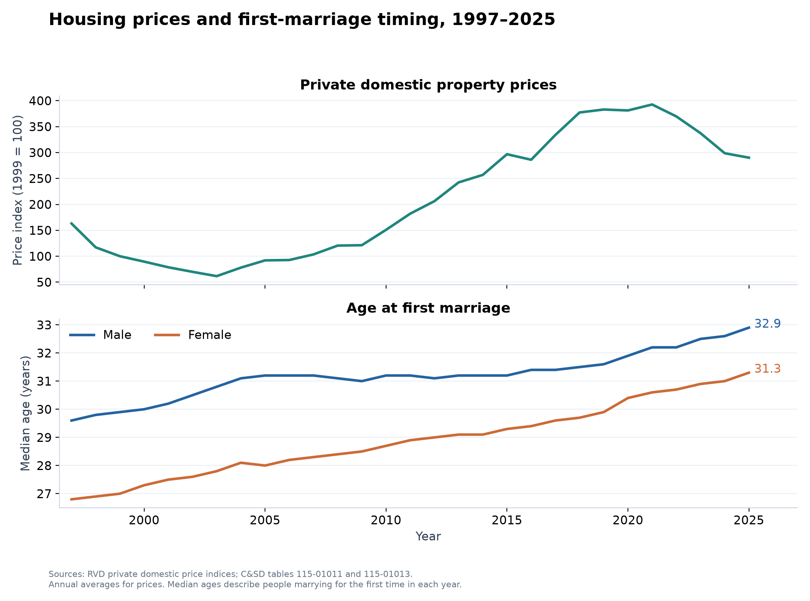
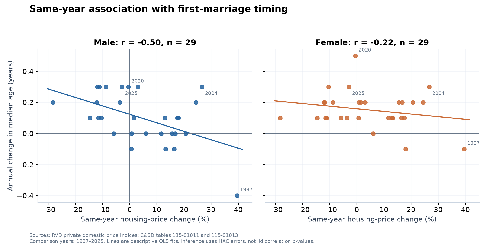
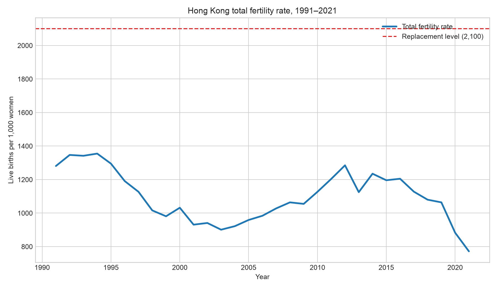

# Xian Haoran

I am a data science student interested in turning public datasets into clear, reproducible evidence. This portfolio highlights projects that combine data cleaning, exploratory analysis, visualization and communication.

## Technical skills

- Python, pandas and Matplotlib
- Jupyter notebooks and reproducible scripts
- Data cleaning, descriptive statistics and visualization
- Git, GitHub and GitHub Pages

## Project showcase

### Housing Prices and First Marriage in Hong Kong (1997–2025)

**Research question:** How are annual housing-price changes associated with first-marriage timing and age patterns?

This semester team project combines official RVD housing-price indices with C&SD marriage statistics. My role was team coordinator and reporter: organizing progress, explaining the motivation and data, and communicating EDA and the limits of the evidence. The analysis and code are team work, not my independent authorship.

Median first-marriage age rose from 29.6 to 32.9 for men and 26.8 to 31.3 for women. These long-term trends differ from the annual-change relationships tested below.

The male same-year correlation is −0.504 across 29 years, but none of the four primary HAC tests meets the 5% threshold after Holm adjustment. The association weakens when 1997 is excluded. These aggregate associations do not establish causation or describe individual decisions.

- **Project repository:** [Housing and marriage project files](https://github.com/XIANHAORAN-mc642513/data-science-portfolio/tree/main/housing-marriage)
- **Methods, sources and reproduction:** [Project README](https://github.com/XIANHAORAN-mc642513/data-science-portfolio/blob/main/housing-marriage/README.md)
- **Notebook:** [Analysis with recorded outputs](https://github.com/XIANHAORAN-mc642513/data-science-portfolio/blob/main/housing-marriage/outputs_v2/housing_marriage_analysis_v2.ipynb)
- **Status:** Analysis V2 completed; further robustness and population-denominator work planned.
- **Review record:** [Peer feedback and portfolio improvements](https://github.com/XIANHAORAN-mc642513/data-science-portfolio/blob/main/REVIEW.md)

### Hong Kong Fertility Trends (1991–2021)

**Research question:** How did Hong Kong’s fertility level and number of live births change from 1991 to 2021, and how did the trend compare with the replacement level?

The analysis shows a long-term decline in the total fertility rate, from 1,281 live births per 1,000 women in 1991 to 772 in 2021. The rate stayed below the 2,100 replacement benchmark throughout the period. A temporary rebound around 2012 was followed by a renewed decline.

- **Project repository:** [Hong Kong Fertility Trends](https://github.com/XIANHAORAN-mc642513/data-science-project)
- **Limitations:** Descriptive annual totals cannot identify why fertility changed or separate age, policy and economic effects.
- **Status:** Completed exploratory analysis; future improvements are planned.

### CISC7204 Assignment 02: Data Visualization with Python

This coursework covers data preparation, statistical graphics, geospatial visualizations, and interactive dashboards across five modules. It includes notebooks, Dash source code, supporting datasets, and screenshots.

- **Coursework files:** [CISC7204 Assignment 02](https://github.com/XIANHAORAN-mc642513/data-science-portfolio/tree/main/cisc7204-Assgn02-2026-mc642513)
- **Collaboration:** Pair work with Guo Qizhen (MC642380); individual artifacts are identified in the files.

## Contact

The source code and data documentation for this project are available in the linked repository.
