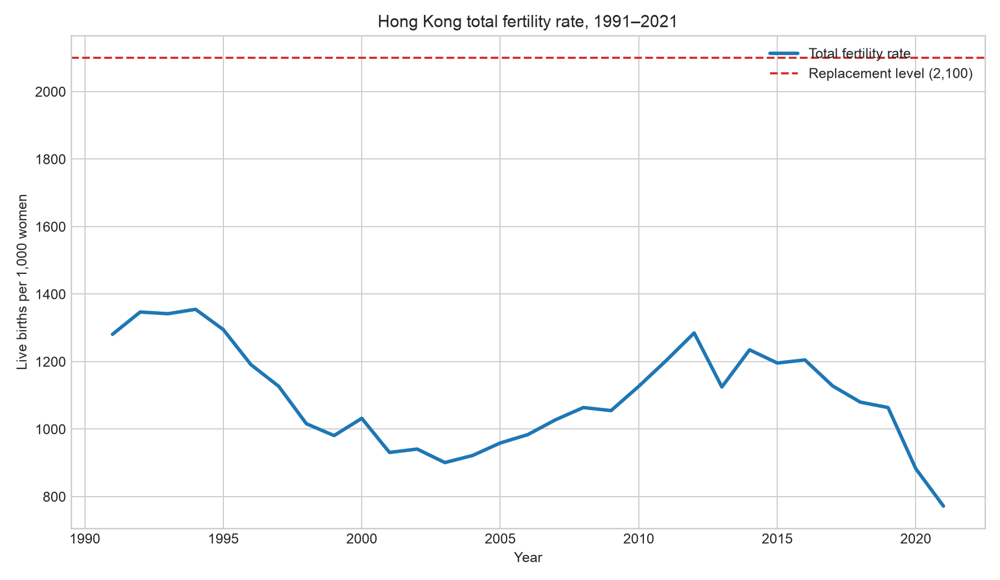

title: Xian Haoran — Data Science Portfolio
description: Selected data science projects by Xian Haoran.

# Xian Haoran

I am a data science student interested in turning public datasets into clear, reproducible evidence. This portfolio highlights projects that combine data cleaning, exploratory analysis, visualization and communication.

## Technical skills

- Python, pandas and Matplotlib
- Jupyter notebooks and reproducible scripts
- Data cleaning, descriptive statistics and visualization
- Git, GitHub and GitHub Pages

## Project showcase

### Hong Kong Fertility Trends (1991–2021)

**Research question:** How did Hong Kong’s fertility level and number of live births change from 1991 to 2021, and how did the trend compare with the replacement level?

The analysis shows a long-term decline in the total fertility rate, from 1,281 live births per 1,000 women in 1991 to 772 in 2021. The rate stayed below the 2,100 replacement benchmark throughout the period. A temporary rebound around 2012 was followed by a renewed decline.

- **Project repository:** [Hong Kong Fertility Trends](https://github.com/XIANHAORAN-mc642513/data-science-project)
- **Status:** Completed exploratory analysis; future improvements are planned.

### CISC7204 Assignment 02: Data Visualization with Python

This coursework covers data preparation, statistical graphics, geospatial visualizations, and interactive dashboards across five modules. It includes notebooks, Dash source code, supporting datasets, and screenshots.

- **Coursework files:** [CISC7204 Assignment 02](cisc7204-Assgn02-2026-mc642513/)
- **Collaboration:** Pair work with Guo Qizhen (MC642380); individual artifacts are identified in the files.

## Contact

The source code and data documentation for this project are available in the linked repository.
